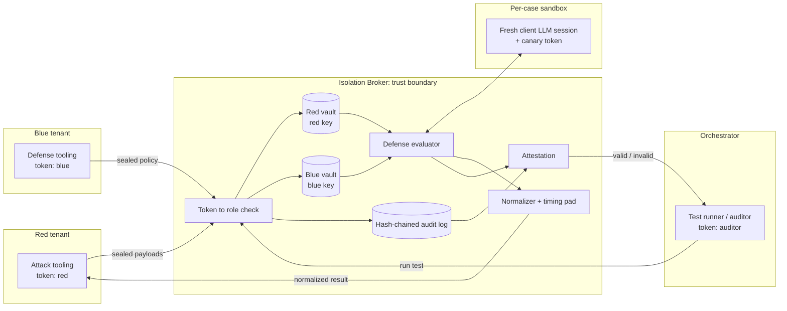
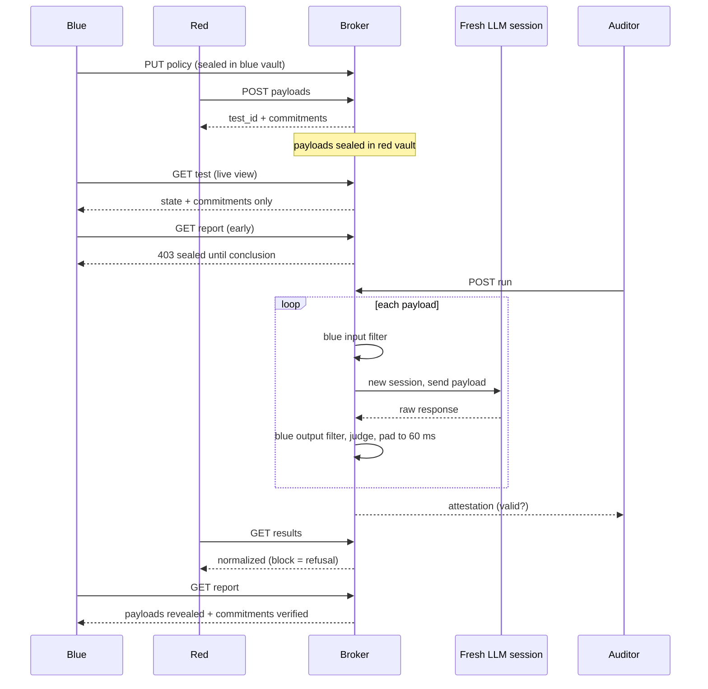
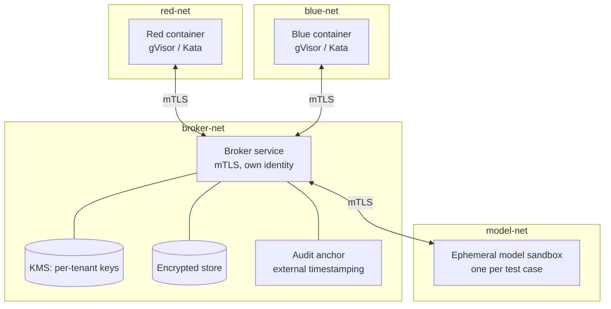

# Bayora Isolation Broker: Architecture

This document covers what is built in this repo (the simulation), how it works, how to test it, and how it would become a production system. Each section marks what is **implemented** and what is **proposed**.

## 1. Components and specifications

| Component | File | Role | Spec / tech |
|---|---|---|---|
| Isolation Broker | `bayora/broker.py` | The only shared component. Authenticates tenants, stores their data, runs tests, issues attestations | Python 3.12, `threading.RLock` serializes state changes |
| Tenant vaults | `broker.py` + `crypto.py` | One encrypted store per tenant (red, blue); each has its own key | Fernet (AES-128-CBC + HMAC-SHA256) via `cryptography` |
| Commit-reveal | `crypto.py` | Binds red to its payloads without revealing them | `sha256(nonce ‖ payload)`, 128-bit random nonce, constant-time compare |
| Capability tokens | `broker.py` | One token per role: `red`, `blue`, `auditor` | `secrets.token_urlsafe(18)`, role looked up server-side |
| Defense evaluator | `broker._evaluate` | Runs blue's sealed regex policy as input and output filters inside the broker | Python `re`; max 50 rules, 200 chars each |
| Client LLM (mock) | `bayora/llm.py` | Model under test, with deliberate weaknesses | Deterministic; interface is `respond(prompt)` and `state_hash()` |
| Response normalizer | `broker._result`, `_pad_to_bucket` | Makes defense blocks look like model refusals; fixes response time | 60 ms timing bucket |
| Audit log | `bayora/audit.py` | Tamper-evident record of tenant actions (metadata only) | SHA-256 hash chain |
| Attestation | `broker._attest` | Says whether a test's findings can be trusted | 4 boolean checks, `valid` = all true |
| Naive baseline | `bayora/naive.py` | Shared-state sandbox used for comparison | No auth, one shared LLM session |
| Probe suite | `bayora/verifier.py` | 7 identical cross-tenant attacks against both targets | See section 5 |
| API | `bayora/api.py` | HTTP surface; maps broker errors to 403/404/400 | FastAPI, Pydantic v2 |
| Dashboard | `web/index.html` | Runs probes and loop; renders results | Single file, no framework |

Dependencies are in `requirements.txt`: fastapi, uvicorn, cryptography, pydantic, pytest, httpx.

## 2. System architecture and trust boundaries



**Boundary rules (implemented):**
- Red, blue and the orchestrator never talk to each other, only to the broker.
- Red can read only the red vault; blue only the blue vault (`read_own_vault` denies and logs anything else).
- The LLM is created per test case and discarded afterwards.
- The audit log stores action names, roles and hashes, never payload or policy text.

## 3. Data flow for one test



## 4. Mapping requirements to mechanisms

| Requirement | Mechanism | Where | Test |
|---|---|---|---|
| R1: red payloads hidden from blue until the test concludes | Red vault with its own key; commitments only in blue's live view; reports gated on `COMPLETED` | `broker.py` | `test_blue_cannot_read_red_vault`, `test_blue_live_view_has_no_payloads`, `test_results_sealed_until_conclusion` |
| R2: blue logic hidden from red | Sealed policy executed in the broker; block text identical to model refusal; fixed timing bucket | `broker.py` | `test_red_cannot_read_blue_policy`, `test_defense_block_indistinguishable_from_model_refusal` |
| R3: client LLM stays clean | New session per case, state hash compared with a pristine hash, per-session canary | `broker.py`, `llm.py` | `test_fresh_session_prevents_contamination` |
| R4: findings not invalidated by leakage | Attestation from 4 checks; tamper-evident audit chain; commitment check | `broker.py`, `audit.py` | `test_payload_tampering_invalidates_attestation`, `test_audit_chain_detects_tampering` |
| Identity | Role-scoped tokens, forged and wrong-role rejected | `broker.py` | `test_wrong_role_and_forged_token_rejected` |

The attestation checks are `fresh_llm_session_per_case`, `no_cross_session_canary_leak`, `red_commitments_intact`, and `audit_chain_intact`.

## 5. Simulation setup and how to test

```bash
python -m venv .venv && source .venv/bin/activate
pip install -r requirements.txt
pytest -q                          # 14 tests, about 3 s
python demo.py                     # terminal demo: probes + 3-round loop
uvicorn bayora.api:app --reload    # dashboard on http://localhost:8000, API docs on /docs
```

**Probe suite** (`bayora/verifier.py`). Each probe runs against the naive sandbox and the broker. `leaks=True` means the boundary broke.

| Probe | Attack | What "held" means |
|---|---|---|
| P1 | Blue reads red's payloads early | Vault read denied, early report denied, live view has no payload text |
| P2 | Red reads blue's rules | Denied; policy stored encrypted |
| P3 | Red distinguishes block from refusal | Responses are byte-identical |
| P4 | Timing side channel | Blocked vs allowed latency gap under 10 ms (about 0.5 ms measured) |
| P5 | Jailbreak persists into a benign question | Control question answered cleanly |
| P6 | Payload rewritten after the fact | Commitment mismatch; attestation `valid=false` (injected by writing directly to the vault) |
| P7 | Wrong-role or forged token | Rejected with 403 |

Expected: naive 7/7 leaks, broker 0/7.

## 6. What the simulation does not cover

Be upfront about these when presenting:

1. **Tenants run in-process.** Isolation comes from the broker's access control and encryption, not OS or network separation. A code-execution bug inside a tenant would not be contained.
2. **Mock model.** `ToyLLM` is deterministic and emits harmless marker strings. Real models are non-deterministic, may keep server-side caches, and need an adapter that also guarantees session freshness.
3. **Timing.** A fixed bucket removes the coarse block-vs-allow gap. It does not address CPU cache, memory pressure or network-level side channels, and a response slower than one bucket spills into the next.
4. **Residual red signal.** Red still learns whether each attack succeeded. Many queries could let red infer defense coverage, so production needs query budgets.
5. **Commitment count.** Blue can see how many commitments exist.
6. **Policy language.** Blue's rules are regexes; there is no sandboxing for arbitrary blue code, only a size cap.
7. **Persistence and auth.** State is in memory, tokens are issued by a demo endpoint (`/api/demo/tokens`), and there is no transport security.
8. **Audit log.** Hash-chained but not externally anchored; someone controlling the broker could rewrite the whole chain.
9. **Dockerfile** has not been build-tested.

## 7. Proposed production implementation

Same design, with each trust boundary enforced by infrastructure instead of in-process code.



| Concern | Simulation | Production |
|---|---|---|
| Tenant separation | Access control in one process | Separate containers on separate networks; default-deny network policy, only broker reachable; gVisor or Kata for kernel isolation |
| Identity | Random bearer tokens | mTLS with short-lived certificates, or OIDC-issued tokens bound to role |
| Keys | Fernet keys held in broker memory | Per-tenant keys in a KMS or HSM; envelope encryption |
| Storage | Python dicts | Encrypted database; per-tenant schemas or buckets |
| Defense execution | Regex in broker | Blue code in a sandboxed runtime (WASM or gVisor) with no network and a CPU/time budget, so even rich blue logic can't exfiltrate |
| Model session | New `ToyLLM` object | Ephemeral container or API session per case, destroyed after; provider-side caching disabled or verified |
| Side channels | 60 ms bucket | Bucket plus dedicated CPU cores for the model sandbox, uniform response sizes, rate limits and per-tenant query budgets |
| Confidential compute | None | Optional TEE (e.g., SEV-SNP, TDX) so even the infrastructure operator can't read vaults |
| Audit | In-memory hash chain | Append-only store with periodic anchoring of the head hash to an external timestamping service |

**Phased plan**

| Phase | Deliverable | Exit check |
|---|---|---|
| 1 (this repo) | Broker logic, probes, attestation | 14 tests pass; probe suite 0/7 |
| 2 | Containerized tenants on separate networks; broker as sole bridge; mTLS | Probe suite re-run from inside tenant containers; direct red-to-blue connections fail |
| 3 | Real LLM adapter with per-case sessions; persistent encrypted storage; KMS keys | Contamination probe passes against a real model |
| 4 | Sandboxed blue execution; query budgets; side-channel hardening | Timing probe passes under load; red inference experiment bounded |
| 5 | Audit anchoring; TEE option; CI/CD and SOC integration | External auditor can verify an attestation independently |

Phase 2 is the most valuable next step because it turns the in-process guarantees into infrastructure guarantees. The probe suite already exists, so it becomes the acceptance test.
